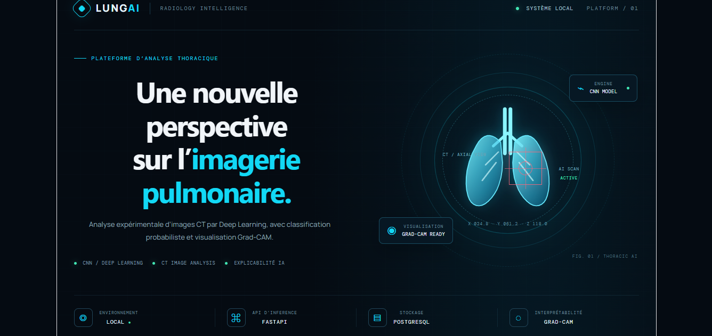
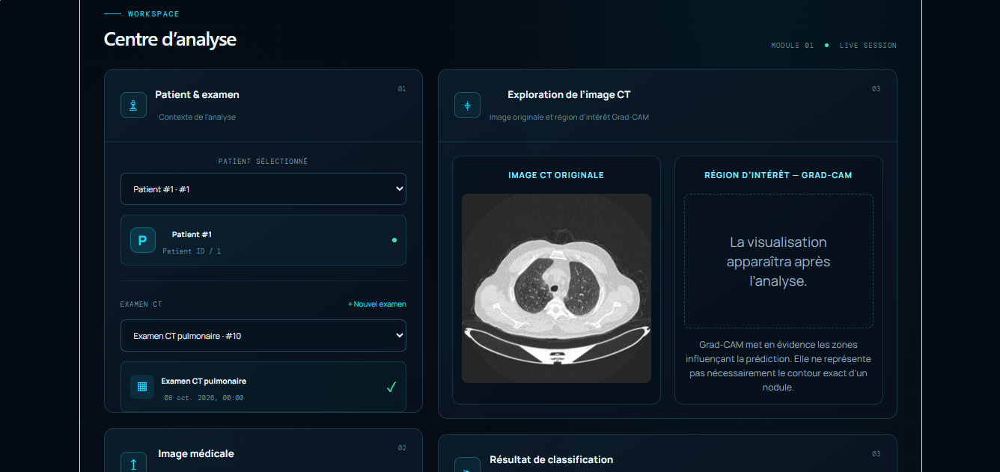
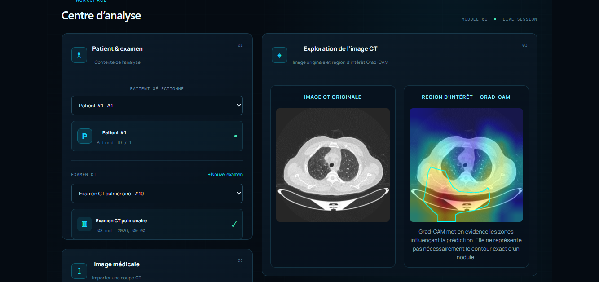
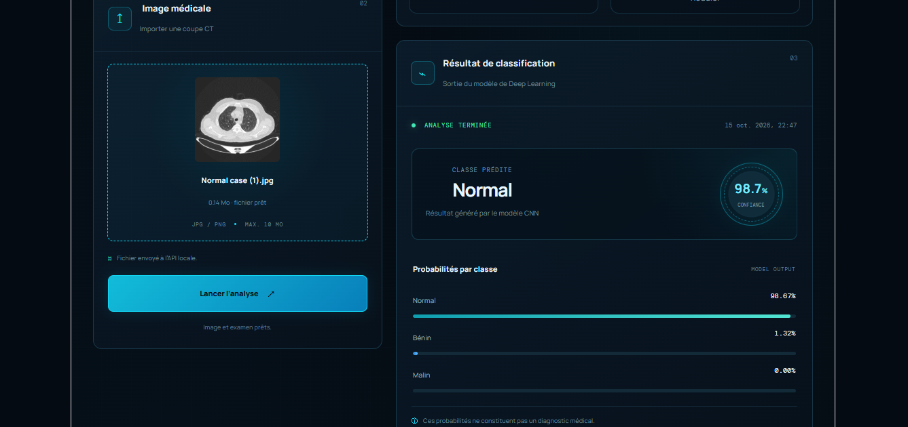
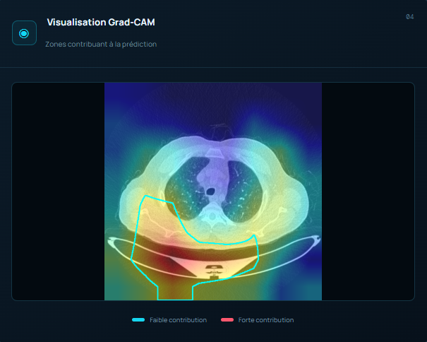
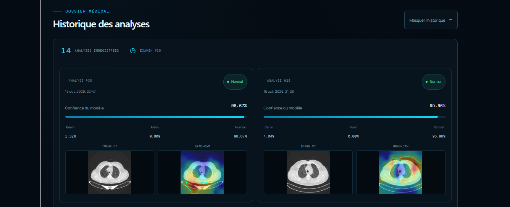

# Lung AI Platform

An AI-powered web application for pulmonary CT image classification using Deep Learning.

## Features

- Classification of CT images: Normal, Benign, and Malignant.
- Prediction confidence and class probabilities.
- Grad-CAM heatmap visualization.
- Patient and examination management.
- Analysis history.

## Tech Stack

- **Backend:** Python, FastAPI
- **Frontend:** React, Vite
- **Database:** PostgreSQL
- **Image Processing:** OpenCV
- **AI:** CNN-based image classification and Grad-CAM

## Getting Started

Clone the repository:

```bash
git clone https://github.com/Salma-MELLAH/lung-ai-platform.git
cd lung-ai-platform
```

Install Python dependencies:

```bash
pip install -r requirements.txt
```

Start the backend:

```bash
cd backend
uvicorn main:app --reload
```

Start the frontend in a separate terminal:

```bash
cd frontend
npm install
npm run dev
```

Configure your PostgreSQL connection in the backend `.env` file before running the application.















## Author

**Salma Mellah** — AI Engineering 

[GitHub Repository](https://github.com/Salma-MELLAH/lung-ai-platform)


